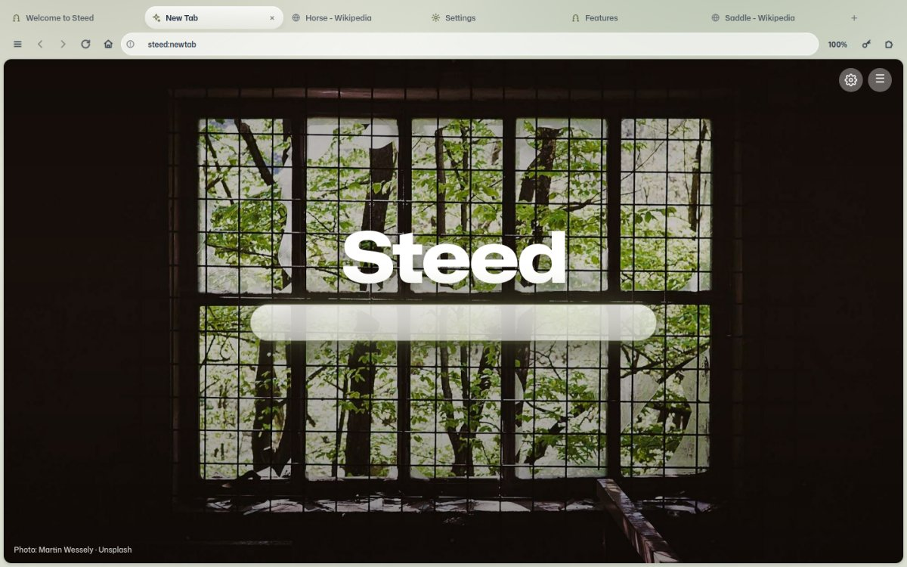
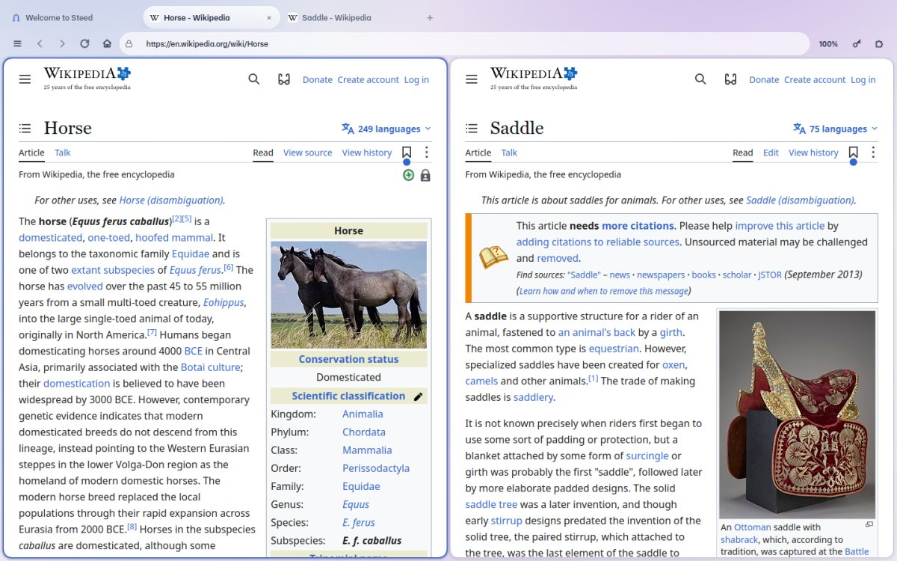

# Steed

A browser for every day that can become whatever you need.

> **Early preview.** Steed is a personal project under active development:
> Linux only, run from source, not yet packaged or security-reviewed for
> general use. See [Good to know](#good-to-know) and the
> [release plan](docs/RELEASE_PLAN.md).



Steed is a Linux desktop browser (Python, PyQt6 and Qt WebEngine). Out of the
box it is a calm, ordinary browser: tabs, profiles, passwords, bookmarks,
history. Underneath it is a sandbox. Restyle every page, rearrange the browser,
add your own scripts and panel apps, and, if AI is part of how you work, bring
your agent into the browser to watch pages, sort tabs, compare products, fill
in forms and run whole workflows, always with your approval. Nothing of that
is in your way until you go looking for it.

## Everyday browsing

- Profiles kept apart, an incognito profile, and per-site permissions.
- Tab groups, saved groups, session history, sleeping tabs, split view.
- A built-in password manager (encrypted vault, generator, breach check,
  passkeys) and bookmark, history and password import.
- Site apps (a site in its own window), read aloud, keyboard link hints,
  search inside pages you've read, and your own shortcuts for everything.
- Printing, spell check, a bookmarks bar, reader view, translation, dictation
  (`Ctrl+Shift+Space`), dark websites, ad and tracker blocking, warnings for
  phishing and malware sites, Chrome (Manifest V3) extensions.



## Make it yours

- Lumen, Steed's look: the page floats in light that takes each site's colour.
  Motion, light, fonts, corners and colours are all settings.
- `steed:style` for themes and CSS on any site; user scripts and panel apps;
  editable New Tab and Welcome pages; a rearrangeable toolbar and menus.

## Bring your AI, any AI

Steed is not tied to one AI company. Use whatever assistant you like, and
switch whenever you want; every one gets the same tools and the same rules.

- Any model, with nothing else to install: a local one (Ollama, LM Studio,
  llama.cpp) or any OpenAI-compatible service with your own API key.
- Coding agents in the sidebar: Codex, Claude Code, or any Agent Client
  Protocol agent; and local MCP access for any other client.
- Chatbot websites (ChatGPT, Claude, Gemini) in the sidebar, and a private
  pairing link that lets claude.ai, ChatGPT or a cloud agent use Steed's
  tools, asking you about everything.
- Routines: your agent on a schedule ("every morning, read my inbox and
  calendar and tell me what matters").
- Ask about a page or selection, watch a page and act when it changes,
  organize or compare tabs, hand a tab to your agent and take it back.
- You review what agents ask to do and choose what each may do (or, for agents
  you trust, let Steed approve for you).

## Quick start

Requires Python 3.10+ and a Linux desktop. From the project directory:

```bash
./install.sh            # or ./install.sh --default to make it your default browser
```

Then open Steed from your applications menu (or run `./steed`). Later,
`./install.sh --update` brings the newest version; Steed tells you when there
is one.

## Good to know

- Linux only, run from this folder (no package yet).
- The PyPI engine cannot play H.264/AAC video; `.venv/bin/python -m
  browser.build_codecs` builds one that can
  ([details](docs/install.md#installation)). Netflix-style protected video works
  when Chrome, Chromium or Firefox has already installed Google's Widevine
  module (see `steed:features`).

## Learn more

- [Documentation](docs/README.md): installing, using and configuring Steed,
  agents, and how it is built.
- [Roadmap](ROADMAP.md): where things stand and what is next.
- [Release plan](docs/RELEASE_PLAN.md): the road to a public release.

## The code

| Folder | What is in it |
| --- | --- |
| `browser/` | The browser: windows, tabs, profiles, storage, passwords, extensions |
| `ui/` | Dialogs, widgets and Steed's own pages (`ui/web/`) |
| `services/` | Agent tasks, permissions, providers, app connections, workers |
| `connectors/`, `examples/` | App connection recipes and examples |
| `tests/` | `unittest` suites and smoke scripts |
| `docs/` | Documentation, screenshots and older notes |

`main.py` starts Steed; `agent_mcp.py` is what agents run to connect to it.
[AGENTS.md](AGENTS.md) has the conventions for contributing (people and
coding agents alike).

## Licence

Steed is free software under the [GNU General Public License v3](LICENSE)
(PyQt6, which it is built on, is licensed under the GPL v3).
